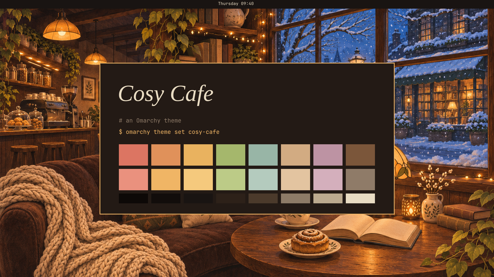

# Cosy Cafe

An [Omarchy](https://omarchy.org) theme: a café on a winter evening, seen from a table inside. Espresso and walnut for the room, cream for the text, lamplight for whatever is lit. Its day companion is [Cosy Cafe Paper](https://github.com/ramtinJ95/omarchy-cosy-cafe-paper-theme).



## Install

```
omarchy theme install https://github.com/ramtinJ95/omarchy-cosy-cafe-theme
```

Or in Omarchy: Super+Space, then Install > Style > Theme, and paste the URL. It installs as `cosy-cafe`.

## The palette

Every color is taken from the room and named for it in `colors.toml`, with its contrast against the page: berries, the bun, the lamp's shade, ivy, sage, a biscuit, heather. There is no blue: where other themes have it (folders in a listing, the prompt's path) this one has the biscuit, and the only blue left is the dusk outside the window in the wallpaper.

## What is in it

- `colors.toml`: the palette. Everything Omarchy themes from a palette follows it: the bar, window borders, the terminals, Neovim, VS Code, Obsidian, Pi, the browser and the rest.
- `shell.*.toml`: the menu, launcher, notifications, popups, tooltips, password prompt and controls. Cards are the café's walnut board, a shade warmer than the page, with the lamp's border; the chosen row is lit in amber.
- `btop.theme`: Omarchy's generated one with the graphs retuned, from ivy through lamplight to berries.
- `claude.json`: Claude Code's colors tuned by hand (a walnut band behind your own messages, moss and brick diffs). Pick it once with `omarchy-theme-set-claude --activate`.
- `backgrounds/`: two paintings of the café in the evening, made with an image model.
- `icons.theme`: Yaru's brown folders.

Windows keep Omarchy's square corners and no shadows; the focused window's border runs from lamplight at the top to brass at the foot.

## Not in it

The boot and disk-unlock screen keeps Omarchy's own logo. GTK apps and the file manager get Omarchy's dark switch and nothing more.
